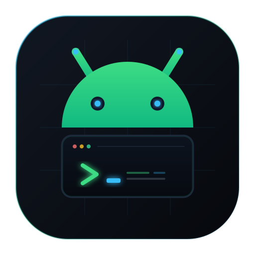
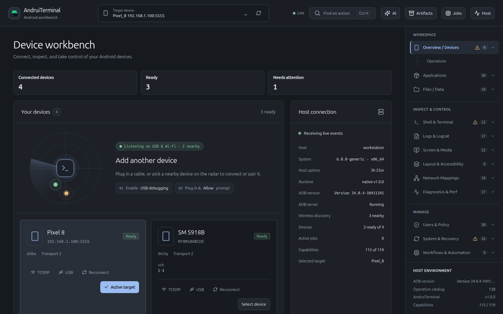
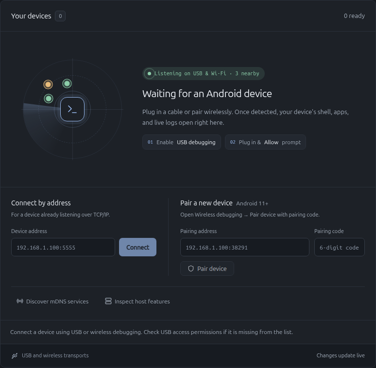
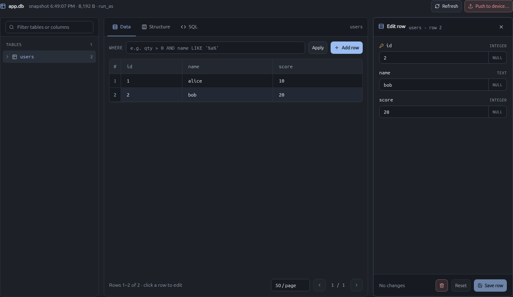
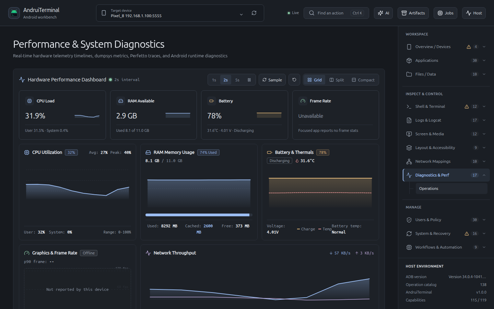
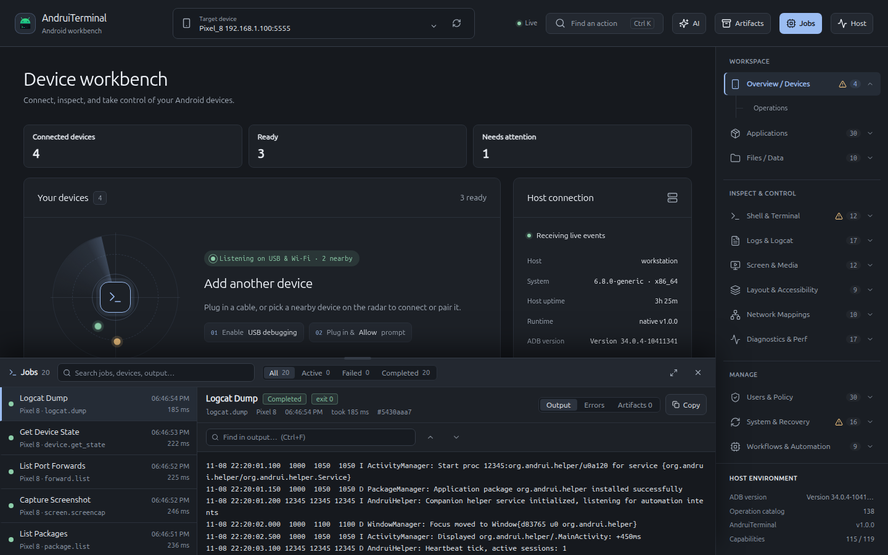
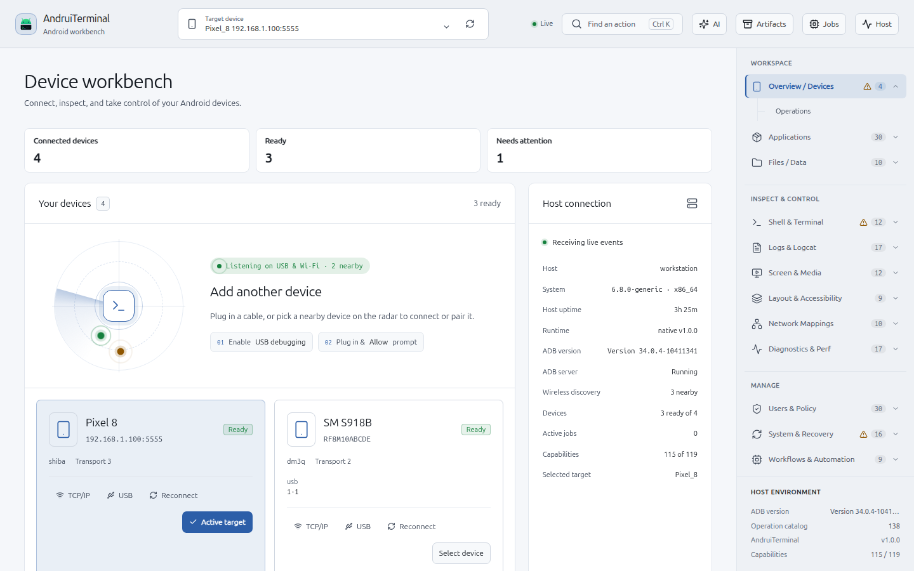

<div align="center">
  
  <h1>AndruiTerminal</h1>
  <p>
    <b>Your Android devices, in a browser tab.</b><br>
    A local workstation for ADB: devices, shell, screen mirroring, diagnostics and automation, served from your own machine.
  </p>
  <p>
    <a href="LICENSE"></a>
    
    
    
    
  </p>
  <p>
    <a href="#-install">Install</a> ·
    <a href="#-what-you-can-do">Features</a> ·
    <a href="#-a-closer-look">Screenshots</a> ·
    <a href="#-documentation">Docs</a> ·
    <a href="#-development">Development</a>
  </p>
  
</div>

---

## ✨ What you can do

| Area | What it does |
|---|---|
| 📱 **Devices** | See every device in every state, connect over USB or Wi-Fi, pair with a code, and spot phones advertising wireless debugging on a live discovery radar. |
| 🖥️ **Screen mirroring** | Watch and control the phone live (scrcpy 3.3.1, decoded in the browser), with navigation keys, text input, clipboard sync and recording. |
| ⌨️ **Shell** | A real interactive terminal on the device, plus one-shot commands with exit codes. |
| 📊 **Diagnostics** | Live CPU, memory, battery, thermal and network charts, dumpsys and system properties. |
| 📦 **Apps & files** | Install, launch, stop and inspect packages; browse an app's SQLite databases table by table and edit rows; browse, preview and transfer files. |
| 🧠 **AI assistance** | Reviewed diagnostic chat, local/remote HTTP model gateways, workflow proposals, MCP agent permissions and saved reports. |
| 🔗 **Integrations** | Device profiles, TV remote, owned AVD lifecycle, workflow CLI/JUnit and semantic Appium export. |
| 🤖 **Automation** | UI hierarchy inspection, semantic actions, OCR, image matching, action recording/replay and multi-step workflows. |
| 🧾 **Jobs** | Every operation runs as a job with streamed output, status, timing and downloadable artifacts, all searchable. |
| 🎨 **Themes** | Five color themes, each in dark and light. |

> [!NOTE]
> AndruiTerminal runs as **your user** and listens on **127.0.0.1 only**. Nothing is exposed to the network, nothing runs as root, and it uses your distribution's `adb`.

## 🚀 Install

AndruiTerminal is packaged for Debian and Ubuntu. `apt` pulls in `adb`, `tesseract-ocr` and the Android USB udev rules.

```bash
cargo install cargo-deb                                     # once
./scripts/build-deb.sh                                      # builds web UI, helper APK and binary, then the .deb
sudo apt install ./target/debian/andrui-terminal_<version>-1_amd64.deb
systemctl --user enable --now andrui-terminal
```

Open **<http://127.0.0.1:19801>**. Your data lives in `~/.local/share/andrui-terminal`.

### Connect your phone

1. On the phone, enable **Developer options** → **USB debugging** (and **Wireless debugging** for Wi-Fi).
2. Plug it in, or stay on the same network: it appears as a dot on the discovery radar in **Your devices**. Click it to connect, or to fill in the pairing form.
3. Accept the debugging prompt on the phone. The device card turns **Ready**.

<div align="center">

</div>

## 📸 A closer look

<table>
  <tr>
    <td width="50%"><br><sub><b>App databases</b>: tables, paged rows, a row editor and SQL, all on a host copy.</sub></td>
    <td width="50%"><br><sub><b>Diagnostics</b>: live CPU, memory, battery and network telemetry.</sub></td>
  </tr>
  <tr>
    <td width="50%"><br><sub><b>Jobs</b>: search, filter by status, read output and errors.</sub></td>
    <td width="50%"><br><sub><b>Light themes</b> for daytime work.</sub></td>
  </tr>
</table>

<sub>Screenshots use the bundled fake ADB (`tests/fixtures/`) with sample devices and data; no real phone is shown.</sub>

## 📚 Documentation

| Guide | What's inside |
|---|---|
| [Architecture](docs/ARCHITECTURE.md) | Specification, runtime and security model, host ADB notes |
| [API](docs/API.md) | HTTP API v1 · screen: [Media](docs/MEDIA.md) · automation: [Automation](docs/AUTOMATION.md) |
| [Packaging](docs/PACKAGING.md) | Building and installing the .deb, versioning and releases |
| [Development](docs/DEVELOPMENT.md) | Repository layout, running from source, tests, fake ADB |
| [AI & device enhancements](docs/UX_AI_DEVICE_ENHANCEMENTS.md) | Behavior, setup, integrations and verification limits |
| [Feature coverage](docs/FEATURE_COVERAGE.md) | What's implemented, what's verified, known limits |

## 🛠️ Development

```bash
cargo build --bin andrui-terminal
(cd web && npm ci && npm run build)
./scripts/run-dev.sh            # http://127.0.0.1:19811, data in .runtime/; runs beside the installed service
```

<details>
<summary><b>Tests and checks</b></summary>

```bash
cargo fmt --check && cargo clippy --workspace --all-targets && cargo test --workspace
(cd web && npm run typecheck && npm test)
python3 tests/smoke/api-smoke.py --binary ./target/debug/andrui-terminal   # uses the fake ADB fixture
```

The fake ADB in `tests/fixtures/` emulates ADB 34.0.4 across every device state, so most work needs no phone. See [Development](docs/DEVELOPMENT.md).
</details>

<details>
<summary><b>Releasing a new version</b></summary>

The version lives once in the root `Cargo.toml`. To release:

```bash
./scripts/bump-version.sh 1.1.0
./scripts/build-deb.sh
```
</details>

> [!IMPORTANT]
> AndruiTerminal is a working workstation, not yet a complete replacement for every ADB command and flag. The typed command catalog was created against reference **ADB 34.0.4** (`1.0.41`). Operations like `forward --list` are marked as **Partial** in [Feature coverage](docs/FEATURE_COVERAGE.md) because while a dedicated command adapter exists, it executes as a raw job without structured JSON modeling, interactive tunnel lifecycle management, or multi-device serial attribution.

## 📄 License

AndruiTerminal is free software under the **GNU General Public License v3.0 or later**; see [LICENSE](LICENSE). The bundled scrcpy server is Apache-2.0 ([LICENSE](crates/andrui-media/LICENSE), [NOTICE](crates/andrui-media/NOTICE)). Notices for bundled Rust crates and npm packages are generated by `scripts/third-party-licenses.py` and installed as `/usr/share/doc/andrui-terminal/THIRD-PARTY-LICENSES`.

The AndruiTerminal logo is based on the Android robot. The Android robot is reproduced or modified from work created and shared by Google and used according to terms described in the Creative Commons 3.0 Attribution License.
